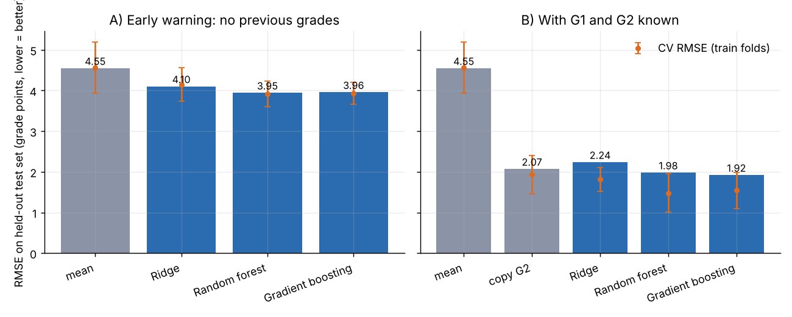
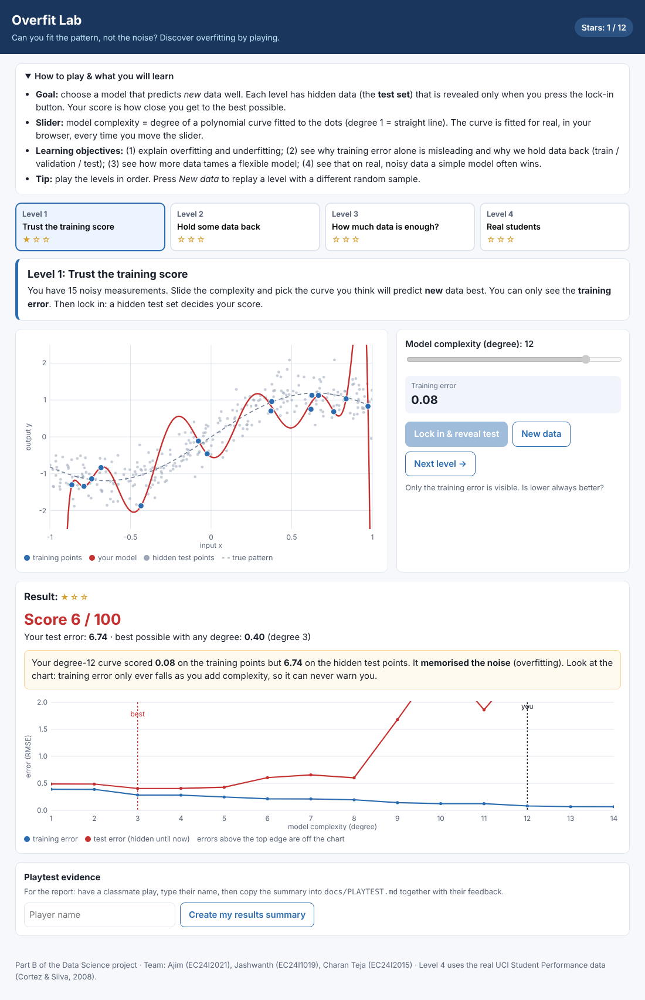

# How Early Can We Predict a Student's Final Grade? + Overfit Lab

Data science project with two parts.

**Team:** Ajim (EC24I2021) &middot; Jashwanth (EC24I1019) &middot; Charan Teja (EC24I2015)

| | |
|---|---|
| **Part A** | Predict a student's final maths grade from the UCI *Student Performance* data, comparing an **early-warning** model (no grades) with a model that knows the period grades G1 and G2. |
| **Part B** | **Overfit Lab**, a browser game in which the player *discovers* overfitting, why we hold data back, and how more data helps. |

## Key results

| Scenario | Test RMSE | Test R² |
|---|---|---|
| Baseline: predict the average | 4.55 | -0.01 |
| **A. Early warning (no grades)**, random forest | 3.95 | 0.24 |
| **B. With G1 and G2**, random forest | 1.98 | 0.81 |

- Background and behaviour alone barely predict final grades. Grades predict grades.
- Copying G2 (RMSE 2.07) is almost as good as the model, so we report that honestly.
- All 38 students with a final grade of 0 have 0 recorded absences, so "absences" partly acts as a dropout marker.



## Quick start

```bash
git clone <your-repo-url>
cd <your-repo-folder>
python -m venv .venv && source .venv/bin/activate      # Windows: .venv\Scripts\activate
pip install -r requirements.txt

python partA/student_grade_prediction.py               # Part A: 1-3 minutes, rewrites figures/ and results/
```

**Play the game (no install):** double-click `partB/index.html`, or open the GitHub Pages link (see below).



## Repository map

```
data/                      student-mat.csv (UCI, CC BY 4.0) and its README
partA/
  student_grade_prediction.py   complete analysis, run end to end
  figures/                      7 figures
  results/                      CSV tables + summary.json
partB/
  index.html                    the game (open in a browser)
  engine.js                     live computation: data, polynomial fit, error, score
  studentdata.js                real (G1, G3) pairs for Level 4
docs/
  REPORT.md                     full report (both parts)
  WALKTHROUGH.md                demo script and viva Q&A
  PLAYTEST.md                   playtest template (fill with real classmates)
  img/                          screenshots
```

## Reproducibility

Fixed random seed (42), preprocessing inside the model pipeline (no leakage), cross-validation on the training set only, final test set used once.
Tested with Python 3.13, pandas 3.0, numpy 2.5, scikit-learn 1.9, matplotlib 3.11. Needs only the four packages in `requirements.txt`.

## Where each marking criterion lives

| Criterion | Where |
|---|---|
| A: Problem and data | Report section 1, `data/README.md` |
| A: Preparation and EDA | Report section 2, `fig01`-`fig03` |
| A: Modelling / analysis | Report section 3, `student_grade_prediction.py` |
| A: Evaluation and interpretation | Report section 4, `fig04`-`fig07`, `results/*.csv` |
| A: Reproducibility and code quality | This README, `requirements.txt`, seeds, one-command run |
| A: Report and presentation | `docs/REPORT.md`, `docs/WALKTHROUGH.md` |
| B: Concept coverage | Report section 6 |
| B: Game design and learning loop | Report section 7 |
| B: Implementation | `partB/` (live computation, real data) |
| B: Documentation and evidence of learning | In-game how-to-play, `docs/PLAYTEST.md` |

## Upload to GitHub

```bash
git init
git add .
git commit -m "Student grade prediction and Overfit Lab"
git branch -M main
git remote add origin https://github.com/<your-username>/<repo-name>.git
git push -u origin main
```

**Host the game for free:** on GitHub go to *Settings, Pages*, choose *Deploy from a branch*, branch `main`, folder `/ (root)`. After a minute the game opens at `https://<your-username>.github.io/<repo-name>/` (the root `index.html` redirects to the game). Put that link here:

`Game link: (paste after enabling Pages)`

## Credits and licence

Code: MIT (see `LICENSE`). Dataset: P. Cortez and A. Silva (2008), UCI Machine Learning Repository, CC BY 4.0. See `data/README.md`.
