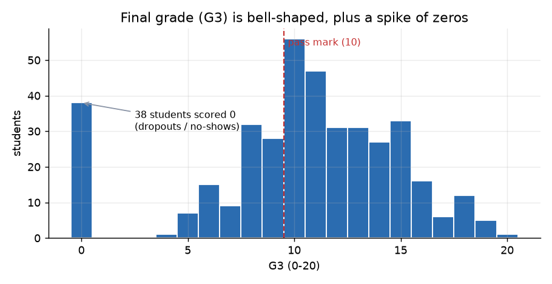
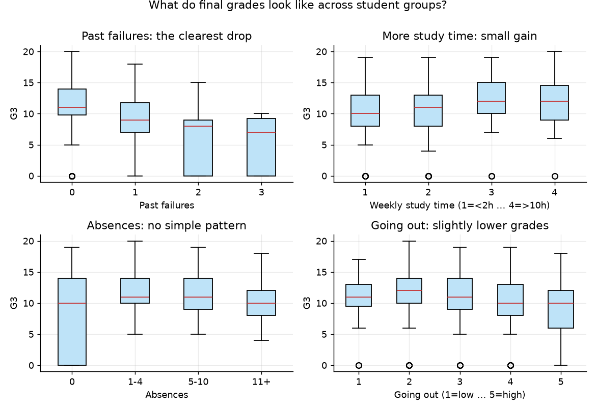
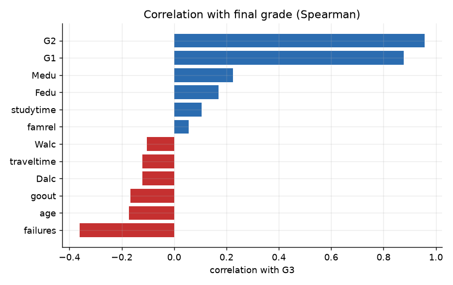
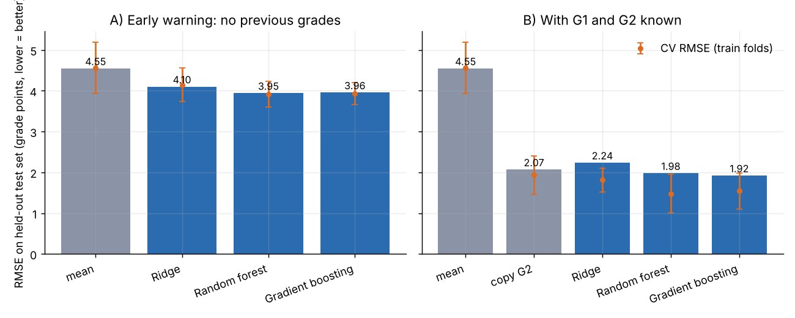
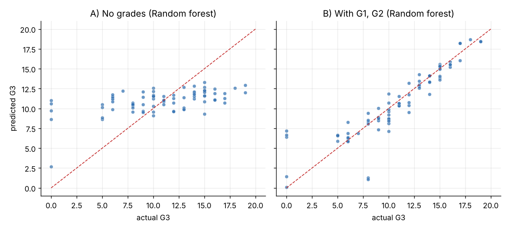
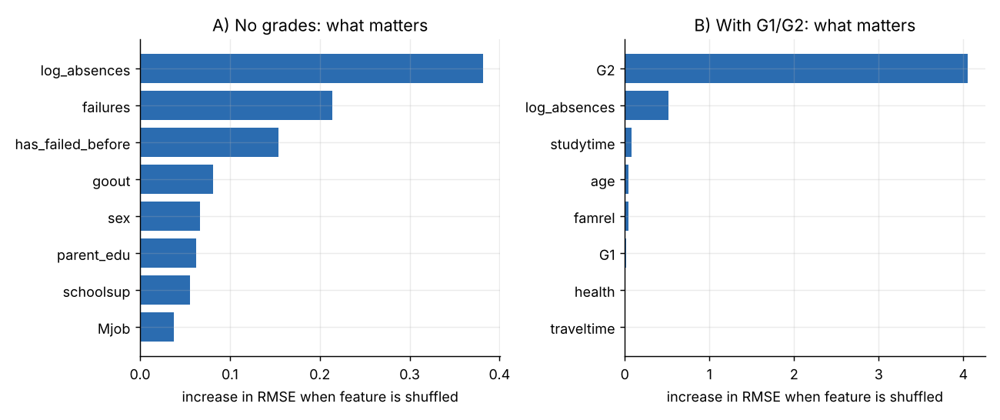
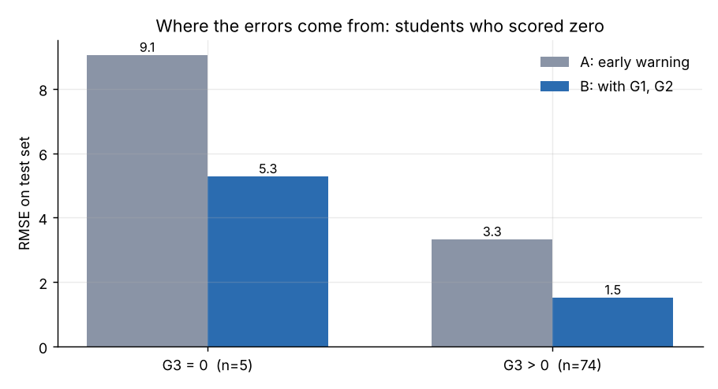
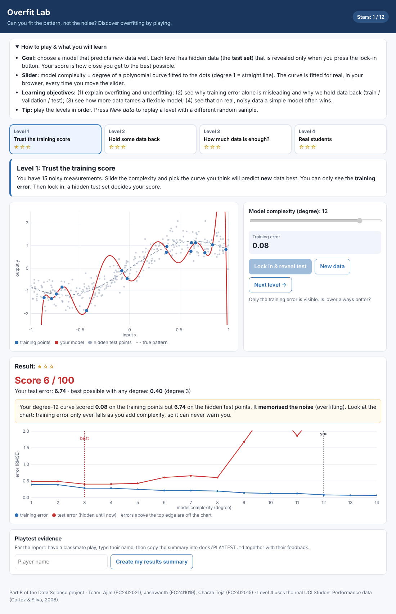
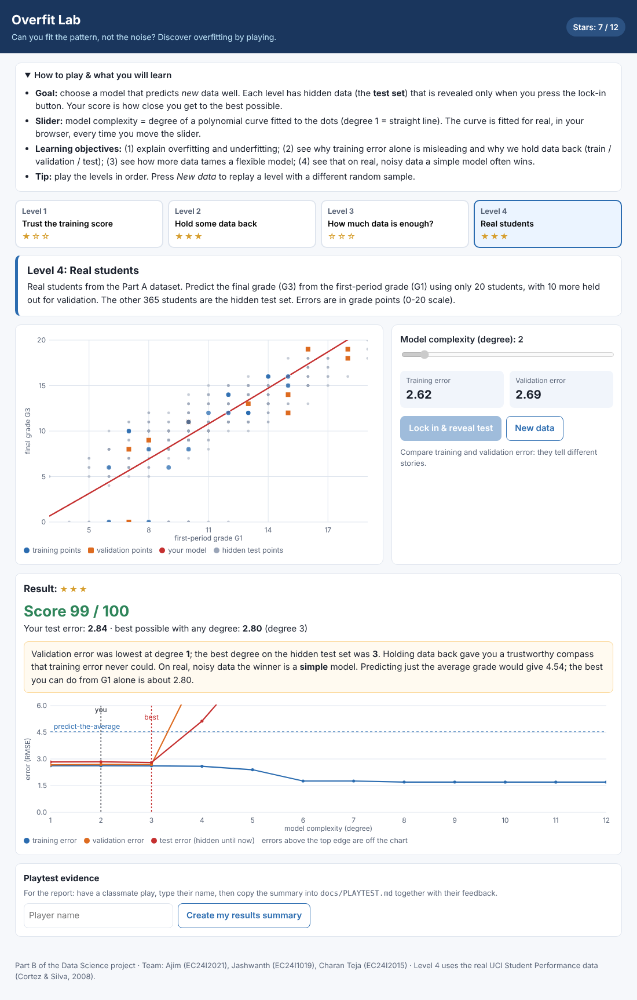

# How Early Can We Predict a Student's Final Grade?
### Part A: Data science project &nbsp;|&nbsp; Part B: *Overfit Lab*, a game for learning data science concepts

**Team:** Ajim (EC24I2021) &middot; Jashwanth (EC24I1019) &middot; Charan Teja (EC24I2015)
**Date:** 17 November 2026

---

## Summary (read this first)

We asked one practical question: **can a school warn a student *before* the exam, and how much does that warning improve once earlier grades are known?**
Using the real UCI Student Performance data (395 maths students), we compared two situations with the same models and the same test set:

| Situation | Best model (chosen by cross-validation) | Test RMSE (grade points) | Test R² |
|---|---|---|---|
| Predict the average grade for everyone (baseline) | none | 4.55 | -0.01 |
| **A. Early warning:** background and behaviour only, no grades | Random forest | **3.95** | **0.24** |
| **B. With period grades G1 and G2** | Random forest | **1.98** | **0.81** |

**Main findings**
1. Without earlier grades, prediction is weak (R² 0.24). Background and behaviour explain only a quarter of the variation in final grades.
2. With G1 and G2 prediction is strong (R² 0.81), but a trivial rule, *"final grade = G2"*, is almost as good (RMSE 2.07). The models add little beyond G2.
3. **Hidden trap in the data:** all 38 students who scored 0 have exactly 0 recorded absences. "Absences" therefore partly acts as a dropout marker, not as a behaviour signal. This inflates its apparent importance.
4. Most of the remaining error comes from just 5 test students who scored 0, not from ordinary students.

Part B is a playable browser game, **Overfit Lab**, that lets a learner *discover* overfitting, the need for held-out data, and the value of more data, using real computation and the same student data.

---

# Part A: Data Science Project

## 1. Problem and data

**Question.** Can we predict a student's final maths grade (G3, scale 0-20) and, more importantly, how much does knowing earlier grades change the answer?
**Why it matters.** A teacher can only act early if the warning comes *before* the period grades exist. If background alone is almost useless, schools must rely on grades, which arrive late.

**Measurable goals**
- Goal 1: beat the "predict the average" baseline (RMSE 4.55) on unseen students.
- Goal 2: quantify how much error falls when G1 and G2 are added.
- Goal 3: find out which factors drive the predictions and where the model fails.

**Dataset and justification.** UCI *Student Performance* (Cortez & Silva, 2008), maths course: 395 students, 33 columns (17 categorical, 16 numeric), from two Portuguese secondary schools. It is real, public (CC BY 4.0), documented, and rich enough to compare "early" and "late" information. It is small, which makes honest validation important (see Section 4). It is not a toy dataset: it has skewed variables, a spike of zeros and a real prediction target.

## 2. Data preparation and exploratory analysis

**Audit (all numbers produced by the code).** 395 rows, 0 missing values, 0 duplicate rows, correct data types. Pass rate (G3 &ge; 10) is 67%. Mean G3 is 10.4 (std 4.6).

**Decisions, each with a reason**

| Issue | What we did | Why |
|---|---|---|
| Missing values | None found, so nothing was imputed | Checked, not assumed |
| Duplicates | None found | Checked |
| `absences` is right-skewed (max 75, 95th percentile 18) | Used `log(1 + absences)`; no student removed | Reduces outlier pull without deleting real students |
| 38 students with G3 = 0 | **Kept** and analysed separately | They are real (probable dropouts or no-shows); deleting them would hide the hardest cases |
| Yes/no and category columns | One-hot encoding inside the model pipeline | Models need numbers; fitted on training data only |
| Two alcohol columns | Merged into one weekly-weighted `alcohol` score | Highly overlapping information |
| Mother's and father's education | Averaged into `parent_edu` | Strongly correlated |
| Past failures | Added a `has_failed_before` flag | The first failure causes the biggest drop |

**Insights from the plots** (each figure was read, not just shown)


*Final grades are roughly bell-shaped around 10-11, plus a separate spike of 38 zeros.* A regression model will struggle with that spike.


*Past failures are the clearest driver:* mean G3 is 11.3 with no failures, 8.1 with one, 6.2 with two and 5.7 with three. Study time helps a little, going out often is slightly negative. The "0 absences" box looks odd (huge spread down to zero): this led us to the data quirk below.


*G2 (Spearman 0.96) and G1 (0.88) dominate.* Among non-grade features the strongest are failures (-0.36), age (-0.17) and going out (-0.17).

**The absences quirk.** All 38 students with G3 = 0 have 0 absences. Among the 115 students with 0 absences, 33% scored zero; among students with at least one absence, 0%. A student who left the course presumably has no attendance record. So "0 absences" is not "perfect attendance" for these students. We keep the feature but test how much we depend on it (Section 4).

## 3. Modelling and analysis

**Method choice.** The target is a number, so this is regression. Two scenarios with the *same* split and models:
- **A (early warning):** all background/behaviour features, **no G1, G2**.
- **B (with grades):** same features **plus G1 and G2**.

**Baselines.** (1) Predict the training mean for everyone. (2) For scenario B, "copy G2" (predict G3 = G2). A model must beat these to be worth using.

**Models (three approaches, beyond the baselines).** Ridge regression (simple, linear), random forest (non-linear, averaged trees) and gradient boosting (sequential trees). Each is tuned with a small grid.

**No leakage, by design**
- Split once: **316 training / 79 test** students (80/20, `random_state=42`). The test set is touched only for the final evaluation.
- All tuning uses **5-fold cross-validation inside the training set**; the folds act as validation sets.
- Scaling and encoding sit **inside the scikit-learn pipeline**, so inside every fold they are fitted on that fold's training part only.
- The "best model" per scenario is chosen by **cross-validation error, not test error**.
- One fixed seed (42) everywhere.

Tuned settings (from `partA/results/model_comparison.csv`): scenario A: ridge alpha=100; forest depth 5, min leaf 3; boosting 200 trees, rate 0.03, depth 2. Scenario B: ridge alpha=10; forest unrestricted depth; boosting 200 trees, rate 0.03, depth 3.

## 4. Evaluation and interpretation

**Metrics and why.** RMSE (penalises big misses, in grade points), MAE (typical miss) and R² (share of variation explained). We add a practical view: treating "predicted G3 below 10" as an at-risk flag, we report accuracy, recall (fails we catch) and precision (flags that are right).

| Scenario | Model | CV RMSE (&plusmn; std) | Test RMSE | Test MAE | Test R² | At-risk recall | At-risk precision |
|---|---|---|---|---|---|---|---|
| both | Baseline: mean | 4.56 &plusmn; 0.63 | 4.55 | 3.65 | -0.01 | 0.00 | 0.00 |
| A | Ridge | 4.15 &plusmn; 0.41 | 4.10 | 3.30 | 0.18 | 0.59 | 0.64 |
| A | **Random forest** | **3.92 &plusmn; 0.31** | **3.95** | **3.17** | **0.24** | 0.33 | 0.56 |
| A | Gradient boosting | 3.93 &plusmn; 0.27 | 3.96 | 3.26 | 0.24 | 0.44 | 0.52 |
| B | Baseline: copy G2 | 1.94 &plusmn; 0.47 | 2.07 | **1.00** | 0.79 | 0.96 | 0.81 |
| B | Ridge | 1.81 &plusmn; 0.30 | 2.24 | 1.62 | 0.76 | 1.00 | 0.66 |
| B | **Random forest** | **1.48 &plusmn; 0.47** | **1.98** | 1.19 | **0.81** | 0.96 | 0.72 |
| B | Gradient boosting | 1.54 &plusmn; 0.44 | 1.92 | 1.15 | 0.82 | 1.00 | 0.73 |



**How to read this**
- **Scenario A:** all three models beat the mean baseline, but only modestly (4.55 &rarr; 3.95 RMSE). On 27 test students who failed, the forest flags only 9 (recall 0.33). Ridge catches more (16 of 27, 0.59) at the cost of more false alarms. **Background and behaviour alone are not a reliable early-warning system.**
- **Scenario B:** error falls by more than half (RMSE 1.98). Predicted-vs-actual points sit close to the diagonal.
- **Honest caveat:** "copy G2" scores RMSE 2.07, only 0.09 worse than the forest, and has a *better* MAE (1.00 vs 1.19). The differences among forest, boosting and "copy G2" are smaller than the cross-validation standard deviation (about 0.45), so we do **not** claim the forest is truly better. Boosting scored slightly better on the test set, but we chose the forest by CV before looking at the test set, and we keep that choice.



**What drives predictions** (permutation importance on the test set)



- Scenario B: **G2 dominates** (shuffling it raises RMSE by 4.05; the next feature, absences, by 0.52). G1 adds almost nothing once G2 is known, since they carry the same information.
- Scenario A: log-absences, failures and `has_failed_before` lead, followed by going out, sex and parents' education.

**Sensitivity check for the absences quirk.** Re-running scenario A **without** absences (`partA/results/sensitivity_no_absences.csv`): forest test RMSE rises from 3.95 to 4.17 and R² falls from 0.24 to 0.15. So part of scenario A's weak skill came from the dropout marker. *Behaviour alone is even weaker than it first looks.*

**Error analysis**



| Group in test set | Scenario A RMSE | Scenario B RMSE |
|---|---|---|
| Students with G3 = 0 (n = 5) | 9.05 | 5.28 |
| Students with G3 > 0 (n = 74) | 3.33 | **1.52** |

Ordinary students are predicted to within about 1.5 grade points in scenario B. The 5 zero-score students dominate the error. The worst misses (`partA/results/biggest_misses_scenarioB.csv`) are students with G1 = 7-10 and G2 = 7-9 whose final grade was 0 (predicted 6.4-7.2), and students with G2 = 7 who in fact scored 8 while the forest predicted about 1. The model has learned that low G2 sometimes means "dropped out", and cannot tell who is which.

**Limitations, bias and risks**
- **Small data:** 395 students and only 79 test students (5 zeros). Test numbers are noisy; this is why we also report cross-validation with spread.
- **One course, two schools, one country:** results may not transfer.
- **Dropout is not predictable here** from the available fields, and the zero grades may mix several causes.
- **Sensitive attributes** (sex, age, parents' education, relationship status) are in the data. A model using them to label a student "at risk" could reinforce unfair treatment. In a real deployment we would drop or audit these and use predictions only to *offer support*, never to penalise.
- **Correlation is not causation:** "going out" being associated with lower grades does not mean banning it would raise grades.

**Next steps.** Model the dropout (G3 = 0) as a separate classification problem; add the Portuguese-course file for more students; use repeated cross-validation for tighter error bars; calibrate the at-risk threshold (a teacher may prefer catching more fails over fewer false alarms).

## 5. Reproducibility and code quality

- Repository with `README.md`, `requirements.txt`, dataset and `.gitignore`.
- One script runs everything end to end: `python partA/student_grade_prediction.py` (1-3 minutes depending on the computer). It writes all figures to `partA/figures/` and all tables to `partA/results/`.
- Fixed seed 42; versions tested: Python 3.13, pandas 3.0, numpy 2.5, scikit-learn 1.9, matplotlib 3.11.
- Code is split into small commented functions (audit, feature engineering, EDA, modelling, evaluation, error analysis).

---

# Part B: *Overfit Lab*, a game for learning data science concepts

## 6. Concepts and learning objectives

The game teaches one idea in four steps, **a model should be judged on data it has not seen**:

| Objective | Level |
|---|---|
| Explain **overfitting** (memorising noise) and **underfitting** | 1 |
| Explain why **training error alone is misleading** and why we split data into **train / validation / test** | 1, 2 |
| See how **more data** reduces overfitting of a flexible model (sampling, variance) | 3 |
| See that on **real, noisy data a simple model often wins** (bias-variance trade-off) | 4 |

It deliberately connects to Part A: Level 4 uses the real G1 and G3 values of the same students.

## 7. Game design and learning loop

**Goal.** Choose the model that predicts hidden test data best. **Controls.** A slider for model complexity (polynomial degree 1-14), and in Level 3 a slider for how many data points to collect. **Feedback.** The fitted curve and the training error update instantly; after lock-in the hidden test points, the true pattern and an error-versus-complexity chart are revealed, plus a score out of 100 and 1-3 stars.

| Level | Situation | Player's decision | What they discover |
|---|---|---|---|
| 1. Trust the training score | 15 noisy points; only training error visible | Pick a degree | Training error always falls, test error explodes. High complexity memorises noise |
| 2. Hold some data back | 20 training + 10 validation points | Pick a degree using validation error | Validation error warns about overfitting, training error cannot |
| 3. How much data is enough? | Model fixed at degree 9 | Choose how many points to collect (10-120) | Flexible models need enough data; error flattens near the noise floor (0.35) |
| 4. Real students | 20 real students predict G3 from G1; 365 test students | Pick a degree | Simple models win on noisy real data; compare with "predict the average" (about 4.5 grade points) |

**Why it is a game and not a quiz.** The player's choices change the outcome and nothing is multiple choice. The concept is *discovered* by noticing that training and test error disagree. **Progression:** each level removes a crutch of the previous one or adds a lever. **Replay:** the *New data* button draws a fresh random sample, so memorising an answer is useless.

## 8. Implementation

- Pure HTML, CSS and JavaScript: opens by double-clicking `partB/index.html`, no server or install. Also deployable on GitHub Pages (root `index.html` redirects to it).
- **Real computation, no hard-coded answers** (`partB/engine.js`): seeded random data, least-squares polynomial fitting (Chebyshev basis, solved by Gaussian elimination) and RMSE are computed live in the browser; the score is measured against the best test error over all degrees, computed on the spot.
- Level 3 reports the **median of 15 repeated data collections** of the chosen size, so one lucky sample cannot decide the result (a flaw we found and fixed during testing).
- Level 4 data (`partB/studentdata.js`) are the 395 real (G1, G3) pairs from the Part A dataset.
- **Testing we did:** the engine was calibrated over 60 random worlds (e.g. a degree-12 pick scores about 2/100 in Level 1, while a validation-guided pick averages about 93/100 in Level 2); the full interface was driven automatically through all four levels with no runtime errors; screenshots were reviewed. This testing also exposed a bug (error readouts lagging one slider step behind the curve), which was fixed.




## 9. Documentation and evidence of learning

- **How-to-play guide and learning objectives** are inside the game (top panel) and in `README.md`.
- **Playtest:** `docs/PLAYTEST.md` holds the protocol, a results table and feedback. The game has a built-in *Create my results summary* button that records each player's choices and errors, so every playtest leaves evidence of what was tried and what score resulted.

---

## References
- P. Cortez and A. Silva (2008). *Using Data Mining to Predict Secondary School Student Performance.* FUBUTEC 2008. Dataset: https://archive.ics.uci.edu/dataset/320/student+performance (CC BY 4.0).
- Pedregosa et al. (2011). *Scikit-learn: Machine Learning in Python.* JMLR 12.

## Appendix: file map
```
data/student-mat.csv                          dataset (+ data/README.md)
partA/student_grade_prediction.py             complete analysis, run end to end
partA/figures/                                7 figures used above
partA/results/                                model_comparison.csv, error_analysis_by_group.csv,
                                              biggest_misses_scenarioB.csv, sensitivity_no_absences.csv, summary.json
partB/index.html, engine.js, studentdata.js   the game
docs/REPORT.md, WALKTHROUGH.md, PLAYTEST.md   this report, demo + viva guide, playtest log
```
